# Bills — Theory session #1 (แหล่งภายนอก)

> ⚠️ **แหล่งภายนอก** — ไม่ใช่คลาส TrackleTrade และไม่ใช่ความรู้ที่นักเรียนป้อน · ครูคนละคน บางคำความหมายไม่ตรงกับคลาส (ดู 🤖 ท้ายไฟล์)
> 🎬 คลิป: [Trading House Online Theory session #1](https://www.youtube.com/watch?v=hqdcPzptcK0) · ช่อง Bills · อัปโหลด 2026-11-09 · ยาว 1:52:16 · พูดอังกฤษ · กราฟ XAUUSD M5/M15 บน TradingView
> 📄 ซับเต็ม [bills_theory01_hqdcPzptcK0.txt](../transcripts/bills_theory01_hqdcPzptcK0.txt) · ภาพคู่คำพูด 12 จุด [bills_theory01_hqdcPzptcK0_moments.md](../transcripts/bills_theory01_hqdcPzptcK0_moments.md)
> 🎬 **(นาที N)** = AI สรุปจากซับอัตโนมัติภาษาอังกฤษ (ถอดเสียงผิดได้) · 🖼️ = AI อ่านจากภาพในคลิป (อาจอ่านพลาด)
> 👁️ จดแบบ**อ่านกราฟ** — ตัวอย่างเทรดจริงของเขา (จุดเข้า / SL / TP / RR) ไม่ได้จดรายละเอียด · ส่วนโปรโมต (ฝากเงิน, แจก Rolex, กลุ่ม Telegram / VIP) ไม่ได้จด
> จดแยกทีละหัวข้อตามที่เขาสอน ไม่รวมกับโน้ตคลาส

## สรุปสั้น (อ่านทวน)

| # | ข้อ |
|---|---|
| [1](#1-ลำดับคอร์สของเขา) | ลำดับคอร์ส: technical → psychology → fundamentals · 3 เรื่องหลัก = **structure · Fib · liquidity** |
| [2](#2-ตลาดทำ-2-อย่าง--impulse-กับ-structure) | ตลาดทำ 2 อย่าง: **impulse** (วิ่งแรง) กับ **structure** (สะสม) |
| [3](#3-fib-คืออะไร-ลากยังไง) | Fib = % การย่อของ impulse · ลาก**ซ้าย → ขวาเสมอ** · buy: ก้นก่อน impulse = 100% → ยอด = 0% |
| [4](#4-fib-23) | **23** — ใช้เฉพาะ momentum แรง ทำ high ใหม่ต่อเนื่อง |
| [5](#5-fib-38--break--retest) | **38** — ใช้เมื่อ bias ชัด · ชอบตอนตรงกับ **break & retest** · ไม่ใช้ตอน ranging |
| [6](#6-fib-50) | **50** — แทบไม่ใช้ · เฉพาะ TF สูงที่ตรงกับ 61 เล็ก |
| [7](#7-fib-61) | **61** — ตัวโปรด แต่**ไม่ซื้อทันทีที่แตะ** · รอไส้ลงไปกวาด 65 / 71 + structure |
| [8](#8-fib-65--71) | **65 / 71** — ไม่เทรดตรง ๆ · เป็นที่รอ liquidity grab แล้วดูราคากลับขึ้นแถว 61 |
| [9](#9-fib-78) | **78** — ไม่ค่อยชอบ · กลับตัวที่ 78 = ยังไม่อยากลงไป 88 |
| [10](#10-fib-88) | **88** — ดีที่สุดตัวหนึ่ง · liquidity ใหญ่ → กลับตัวเร็ว |
| [11](#11-fib-100) | **100** — ไม่เทรด · เป็นจุดเริ่ม Fib และเป็น liquidity |
| [12](#12-structure-ในความหมายของเขา) | **structure** ของเขา = ราคาสะสมบนระดับ **4–5 แท่ง M5** · ทุกระดับ Fib ต้องรอ |
| [13](#13-confluence--อย่างเดียวไม่พอ) | confluence อย่างเดียว**ไม่ใช่** confirmation · นักบินเช็กลิสต์ |
| [14](#14-fib-เล็ก--fib-ใหญ่-และ-tf) | Fib เล็ก (M5) / Fib ใหญ่ (M15+) · TF สูง = โซน valid กว่า |
| [15](#15-แนวรับ--แนวต้าน) | แนวรับ = พื้น · แนวต้าน = เพดาน · ยิ่งทดสอบบ่อยยิ่งแตกง่าย |
| [16](#16-ema-200--sma-200) | **EMA 200 + SMA 200** ใช้เป็นแนวรับแนวต้าน ไม่ใช่บอกเทรนด์ |
| [17](#17-liquidity) | liquidity = เงิน · ถาม "entry / SL / TP ของคนอยู่ไหน" · นับเฉพาะที่**ยังไม่ถูก grab** |
| [18](#18-sweep-กับ-grab) | **sweep** = การกระทำ · **grab** = ผล · grab ดีต้องเร็ว |
| [19](#19-breakout) | breakout = ออกจาก structure · เขาไม่เทรด breakout |
| [20](#20-fakeout) | fakeout = ทะลุแล้วกลับ · แท่งแรงอย่าตกใจ ถาม "ทำไม" · กลับเร็ว ≈ fakeout |
| [21](#21-trend-line) | trend line = confluence เสริม · ลากหลังมี 2 low · ดูครั้งที่ 3–4 |
| [22](#22-คำศัพท์--lot--pip--leverage) | ทอง 1 lot = 100 oz · 1 pip = 10 เซนต์ · leverage |

---

## 1. ลำดับคอร์สของเขา

🎬 **(นาที 9–10, 26):**
- คอร์สแบ่ง 3 ส่วน: **technical** ก่อน → **psychology** → **fundamentals** · ช่วงแรกเป็น technical ล้วน
- เรื่อง technical ที่สำคัญที่สุด 3 อย่าง: **structure · Fibonacci · liquidity**
- วันนี้เป็นพื้นฐาน จะวนซ้ำทุกวันตลอด 21 วัน

## 2. ตลาดทำ 2 อย่าง — Impulse กับ Structure

🎬 **(นาที 10–11):**
- **Impulse** = การเคลื่อนที่แรงจากก้นไปยอด (หรือกลับกัน) **ไม่สร้าง structure** ระหว่างทาง
- **Structure** = ช่วงที่ราคา **consolidate** (สะสม / ออกข้าง)

## 3. Fib คืออะไร ลากยังไง

🎬 **(นาที 11–13, 36, 38–39, 41–43):**
- Fib = **เปอร์เซ็นต์การย่อ (retracement) ของ impulse**
- ลาก**จากซ้ายไปขวาเสมอ** — ลากขวาไปซ้ายไม่ valid เพราะเป็นการวัดการย่อที่เกิดไปแล้ว
- **ฝั่ง buy:** เริ่มที่จุดต่ำสุดก่อน impulse (ปลายไส้ล่าง) = **100%** → ยอด = **0%**
- เลือก impulse ที่ "หลังยอดนั้นยังไม่มี high ใหม่ และหลังก้นนั้นยังไม่มี low ใหม่"
- **ฝั่ง sell:** กลับกัน — จาก high สุดก่อน impulse ลงไปถึง low
- ถ้าราคาทำ **high ใหม่** ต้องย้าย 0% ไปที่ยอดใหม่
- ระดับที่ใช้: **23 · 38 · 50 · 61 · 65 · 71 · 78 · 88 · 100** · ช่วง **61–88 ทำเป็นสีขาว** = ตัวโปรด
- เครื่องมือ = **Fib retracement** แถบซ้ายของ TradingView · เขาโชว์หน้าตั้งค่าให้แคปที่นาที 30:01–30:24
- **ทุกระดับต้องรอ structure** ก่อน (ดู §12)

🖼️ *(จากภาพ นาที 12:28)* Fib ลากจากไส้ล่าง (~4,086 = 100%) ถึงยอด (~4,131 = 0%) · มีเส้น 23.6 / 38.2 / 50 / 61.8 / 65 / 71 / 78.6 / 88.6 — ช่วง 61.8–88.6 เป็นสีขาว · มีเส้น MA แดงกับดำ · ราคาตอนนั้น ~4,112 แถว 38.2

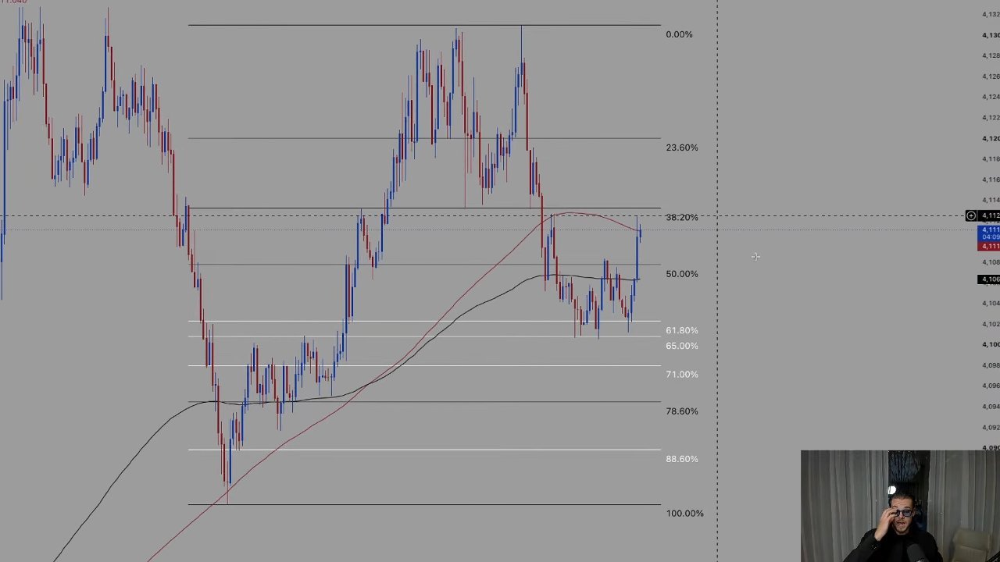

## 4. Fib 23

🎬 **(นาที 13–14):**
- ไม่ค่อยเทรด · ใช้เมื่อ**มั่นใจ storyline** เท่านั้น
- ตัวอย่าง: ช่วงทำ all-time high ต่อเนื่อง ตลาดมักย่อแค่ 23 แล้วขึ้นต่อ ไม่ย่อถึง 38 / 61
- ต้องมี **momentum แรง** (ฝั่ง buy หรือ sell ก็ได้)
- ถ้าตลาด consolidate มาหลายวัน ไม่ทำ high ใหม่ → ไม่ใช้ 23

## 5. Fib 38 + Break & Retest

🎬 **(นาที 14–21):**
- ชอบกว่า 23 · ใช้เมื่อ **fundamental / market idea แข็ง** — ตัวอย่างของเขา: ลดดอกเบี้ยหลายสัปดาห์ → ทองขาขึ้น → bias ฝั่ง buy
- **ไม่ใช้ตอนตลาด ranging** · ตอน consolidate ระดับที่เขาชอบคือ **88** เพราะตลาดจะไปกวาดทั้งคนฝั่งบนและฝั่งล่าง
- ชอบที่สุดตอน 38 ตรงกับ **break & retest**:
  1. ราคาขึ้นทำยอด
  2. ย่อลง — ยอดนั้นกลายเป็น**แนวต้าน**
  3. ขึ้นทะลุยอด = **breakout**
  4. ยอดเดิมเปลี่ยนจากแนวต้านเป็น**แนวรับ** → ราคากลับมา **retest**
  5. ถ้าจุด retest ตรงกับ 38 → รอ structure
- เขาบอกว่า break & retest อย่างเดียวไม่พอ (confluence น้อย · retail ใช้เยอะ) (นาที 1:25)

🖼️ *(จากภาพ นาที 17:01)* วาดมือด้วยพู่กันเหนือกราฟ: ขึ้น → ย่อ → ขึ้นทะลุยอดเดิม (ส่วน "break")

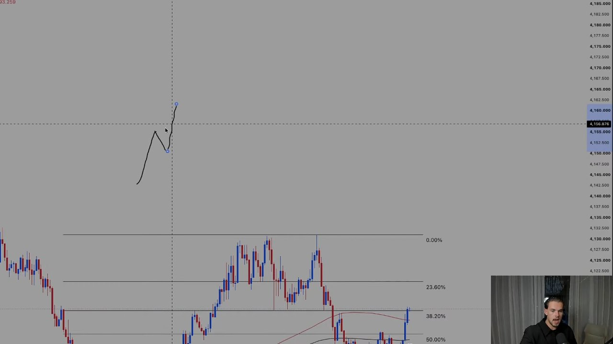

🖼️ *(จากภาพ นาที 20:49)* ภาพวาดมือ + Fib เล็ก (0–118%): ขึ้นทำยอด → ย่อ → ทะลุยอด → ย่อกลับมาแตะเส้นยอดเดิม (เส้นแนวนอน) ซึ่งตรงกับ 38.2%

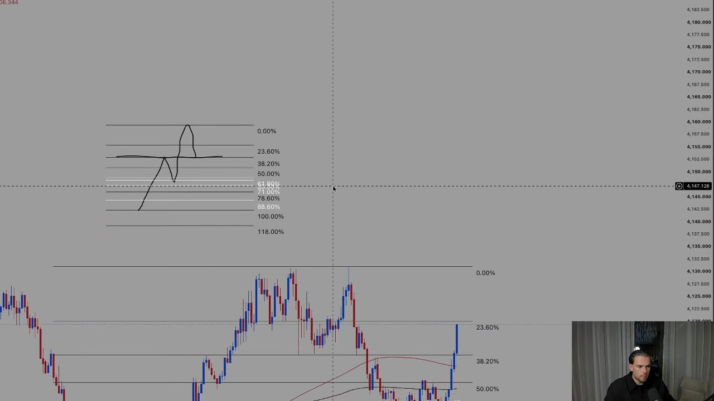

## 6. Fib 50

🎬 **(นาที 21–23):**
- แทบไม่ใช้
- ใช้ได้เฉพาะ **TF สูง (4H)** และต้องตรงกับอย่างอื่น เช่น **Fib 61 เล็ก** ที่ลากใน TF ต่ำ
- 50 อยู่เดี่ยว ๆ ไม่มีอะไรตรง → ไม่ใช้

## 7. Fib 61

🎬 **(นาที 23–33, 44–46):**
- **ตัวโปรด** แต่ใช้ต่างจากคนส่วนใหญ่ — retail ซื้อทันทีที่แตะ หรือตั้ง buy limit รอ
- ภาพที่เขาเล่า: แตะ 61 → **เด้งเร็ว** (คนซื้อเยอะ) → ลงไป**กวาด SL** ที่ 65 / 71 (บางคนวาง SL ที่ 88) → แล้วค่อยไปจริง
- เขารอให้มี **fake push ขึ้นจาก 61 แล้วไส้ลงไปกวาด 65** ก่อน + มี structure
- หลังโดนกวาด คนจะคิดว่า "เป็นขาลงแล้ว" แล้วเปลี่ยนไปขาย — เขาว่าตอนนั้นแหละที่ราคาไปจริง
- 61 **ถูก manipulate บ่อย** แต่เป็นจุดกลับตัวใหญ่ได้ — sell ใหญ่ 2 ไม้วันศุกร์ของเขาอยู่บน 61 / 71 / 88
- เขาเล่าว่าช่วงดึกของ New York เขา**ไม่เข้า retest แรก**ของ Fib
- เขาเล่าเทรดจริงบน 61 พร้อม SL / TP / RR (นาที 28–33, 39–40) — ไม่ได้จดรายละเอียด

🖼️ *(จากภาพ นาที 24:43)* Fib ชุดเดิม · เส้นดำวาดมือ: ราคาลงมาแตะ 61.8 แล้วมีไส้ลงต่อแถว 65 ก่อนพุ่งขึ้น · แท่งน้ำเงินยาวขึ้นทะลุ 23.6

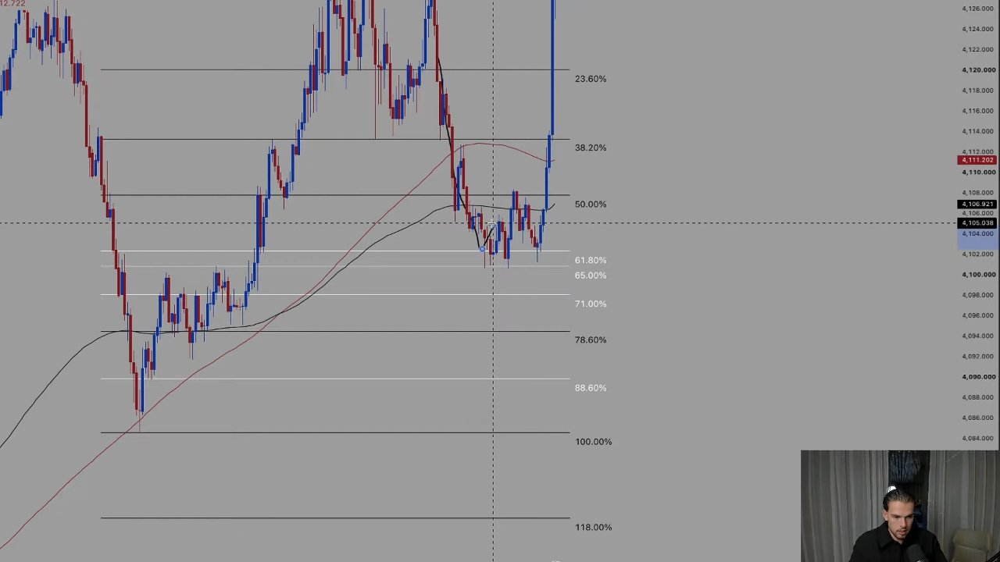

🖼️ *(จากภาพ นาที 46:34 — เวลาที่ส่งมา)* กราฟปัจจุบัน ไม่มี Fib แล้ว · ราคาพุ่งขึ้นถึง ~4,135 · มีแค่ MA แดง/ดำ — ภาพตัวอย่าง sell วันศุกร์อยู่ช่วงนาที 45:14–45:50 ก่อนเฟรมนี้

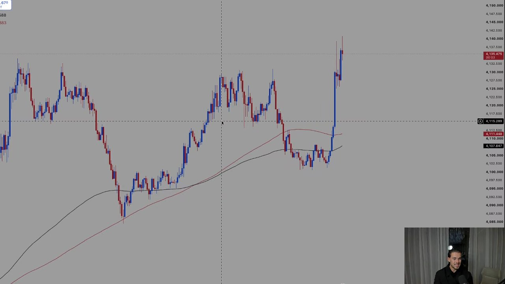

## 8. Fib 65 / 71

🎬 **(นาที 33, 45–46):**
- ไม่เทรดตรง ๆ — เป็นระดับที่**รอ liquidity grab**
- พอแตะ 65 / 71 แล้ว อยากเห็นราคา**กลับขึ้นไปเหนือ 61 หรือใกล้ 61** = กวาด liquidity พอแล้ว
- เขาบอกว่า 71 ก็ทำงานดี จึงรอ 65 และ 71 เสมอ

## 9. Fib 78

🎬 **(นาที 33–35):**
- ความรู้สึกผสม · เคยเทรดเยอะ แต่ retail เริ่มใช้ เลยหันไปรอ 88
- มุมมองเขา: กลับตัวที่ 78 = สถาบัน**ยังไม่อยากลงไป 88** → ไม่ค่อยวิ่งไกล
- ถ้าจะใช้ ต้องตรงกับอย่างอื่น (Fib 61 อีกชุด, MA, trend line, psychological level)

## 10. Fib 88

🎬 **(นาที 35–37, 42–43):**
- ระดับที่ดีที่สุดตัวหนึ่ง — **liquidity ใหญ่**: เป็นที่วาง SL ของคนส่วนใหญ่ และเป็นจุด TP ใหญ่
- liquidity ออกจากตลาดเยอะ → มักเป็น**จุดกลับตัว และกลับเร็ว**
- เป็นระดับเดียวที่เขาว่าเข้าเร็วได้ตั้งแต่**แท่งที่ 2–3** · แต่ยังต้องรอ liquidity ทางซ้ายถูก grab + มี confluence อื่น
- ตัวอย่างวันนั้น: ตลาดขึ้นแรงไม่มี structure ที่ 23–61 → **88 valid** · แตะ 88 **สี่รอบ**ก่อนลง

🖼️ *(จากภาพ นาที 35:29)* Fib ชุดเดิม (มีเส้น 118% เพิ่ม) · cursor ชี้ที่เส้น 88.6% (~4,090)

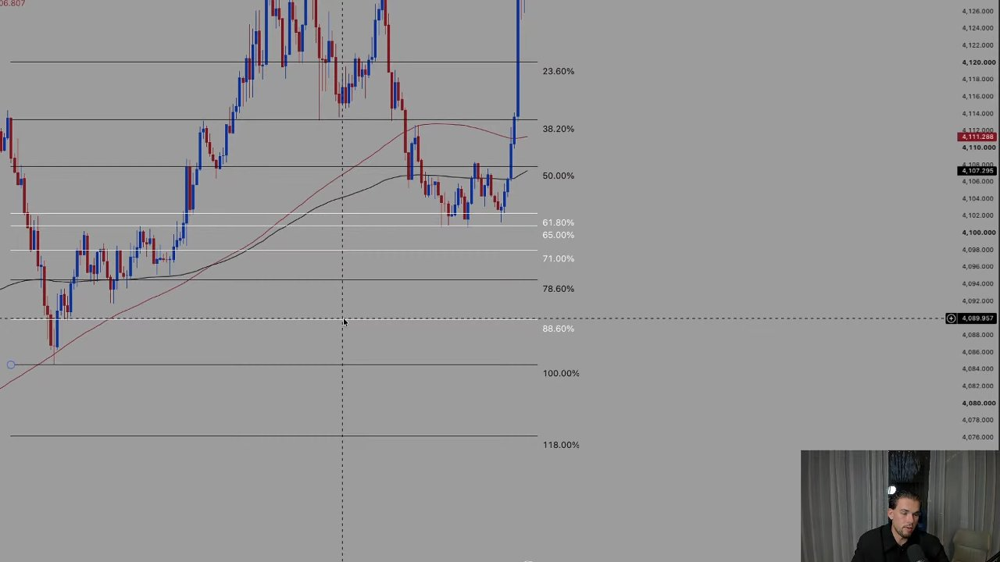

## 11. Fib 100

🎬 **(นาที 41):** ไม่เทรด · เป็นจุดเริ่มของ Fib · เป็น **liquidity** (low สุดก่อนกลับตัว)

## 12. Structure ในความหมายของเขา

🎬 **(นาที 26, 31–32, 34–35, 46, 1:00–1:01):**
- structure = ราคา **consolidate บนระดับ** (key level)
- ดูบน **M5** · รอ **4–5 แท่ง**ดีที่สุด · บางที 3–4 แท่งถ้าอย่างอื่นตรงหมด
- คนในแชตสรุปว่า "consolidation บน key level ราว 4–5 แท่ง" — เขาตอบว่าใช่
- structure มีหลายแบบ ไม่มีแบบไหนเหมือนกันเลย — เลื่อนไปสอนละเอียด session 2

## 13. Confluence — อย่างเดียวไม่พอ

🎬 **(นาที 37–38, 49, 55–56):**
- ไม่เข้าถ้ามี confluence แค่อย่างเดียว — **confluence เดียวไม่ใช่ confirmation**
- นักบินมีเช็กลิสต์ 10 ข้อ เช็กแค่ข้อเดียวไม่ขึ้นบิน
- ที่เขาพูดถึงในคลิป: Fib อีกชุดตรงกัน · EMA / SMA 200 · trend line · psychological level · liquidity grab · ฝั่ง fundamental: silver, DXY
- "ดีที่สุด" ของเขา: Fib 61 ตรง Fib 88 + MA ทั้งสองเส้น + trend line + psychological level + grab liquidity

## 14. Fib เล็ก / Fib ใหญ่ และ TF

🎬 **(นาที 46–48):**
- **Fib เล็ก** = ลากบน TF เล็ก (M5) คลื่นล่าสุด · **Fib ใหญ่** = ลากจากก้นสุดของ impulse ใหญ่ (M15) → เรียก "big 61", "big 88"
- **TF ยิ่งสูง โซนยิ่ง valid** แต่ราคาไปถึงช้า (Fib 4H อาจอยู่ห่าง 2,000 pips)
- วิเคราะห์ M5 / M15 / 1H (บางที 4H) · เข้า M5 · ลาก Fib ดีสุดที่ **M15** · วันอาทิตย์ดู Daily / Weekly
- ใช้ TradingView ดีกว่า cTrader (ชัดกว่า)

🖼️ *(จากภาพ นาที 47:18)* โหมด Replay บน M15 (Thu 05 Nov '26) · Fib ลากบนคลื่นล่าสุดด้านขวา (0% ~4,130 → 100% ~4,080 · ต่อถึง 118%)

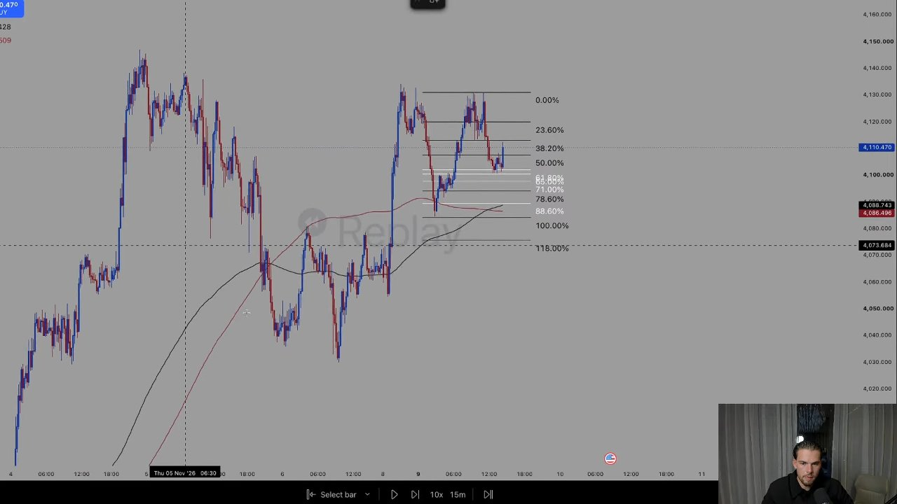

## 15. แนวรับ / แนวต้าน

🎬 **(นาที 53–55):**
- แนวรับ = **พื้น** · แนวต้าน = **เพดาน** · ในมุม Fib: 100% = แนวรับ, 0% = แนวต้าน
- ยิ่ง**ทดสอบบ่อย ยิ่งมีโอกาสแตก** — เหมือนต่อยกำแพงซ้ำ ๆ วันหนึ่งก็พัง

## 16. EMA 200 / SMA 200

🎬 **(นาที 53–1:00):**
- เขาใช้ MA เป็น**แนวรับแนวต้าน** ไม่ใช่ตัวบอกเทรนด์ · ฝั่ง buy = พื้น · ฝั่ง sell = เพดาน
- เป็น **confluence เสริม** — มีแค่ MA อย่างเดียวไม่เข้า
- ตั้งค่า: **EMA 200 + SMA 200** (ค่าเริ่ม 9 ไม่พอ บอกเทรนด์ไม่ได้)
- เขาเล่าว่าลอง 9 / 15 / 50 / 100 / 200 แล้ว 200 ตอบสนองดีสุดในช่วง 5 ปีที่เทรด

🖼️ *(จากภาพ นาที 58:19)* กราฟมี MA 2 เส้น (แดง / ดำ) · ป้ายตั้งค่ามุมซ้ายบนถูกตัด อ่านไม่ออกว่าสีไหน EMA สีไหน SMA

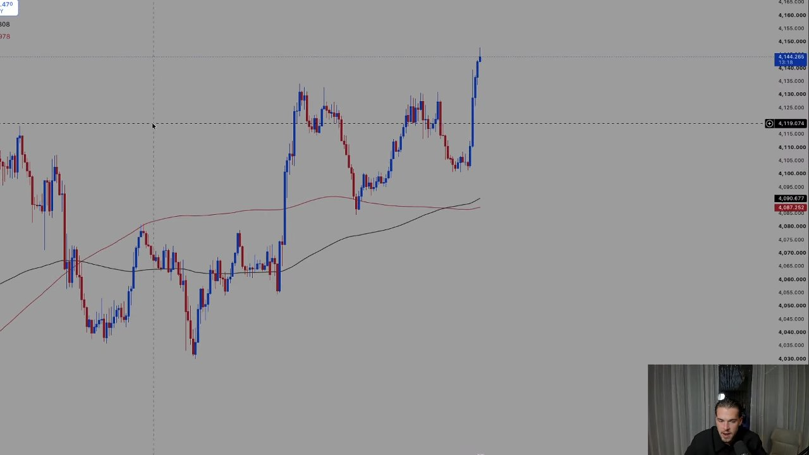

## 17. Liquidity

🎬 **(นาที 1:02–1:06, 1:09–1:12):**
- **liquidity = เงิน** · หาโดยถามตัวเอง: entry ของคนอยู่ไหน · SL อยู่ไหน · TP อยู่ไหน
- สถาบันเงินเยอะ เปิดไม้ใหญ่ทีเดียวไม่ได้ ต้องสร้าง liquidity ก่อน → จึงไปกวาดระดับเหล่านี้ก่อนเคลื่อนจริง
- มักอยู่ที่**ไส้ (wick)** ของจุดที่เคยเกิด structure / กลับตัว · ที่ Fib 88 · Fib 61
- นับเฉพาะระดับที่**ยังไม่ถูก grab** · ถ้าราคาลงไปทำ low ต่ำกว่าแล้ว = SL โดนกวาดไปแล้ว ไม่มี liquidity เหลือ
- เขาแนะนำให้วงไว้บนกราฟ ไม่ต้องลบ จะได้ไม่ลืม
- ตัวอย่าง 4 โซนเทียบกับ Fib: **38 ใหญ่ตรงกับ liquidity เยอะ = ระดับดี** · 50 มี liquidity อยู่ด้านล่าง · 61 ไม่มี liquidity ติด

🖼️ *(จากภาพ นาที 1:05:27)* Replay M15 (Fri 06 Nov '26) · Fib 0% อยู่ล่าง (~4,032) 100% อยู่บน (~4,150) · วงกลมส้ม 4 จุด: ~4,032 (0%), ~4,057 (แถว 23.6), ~4,087 (แถว 50), ~4,103 (61.8–65)

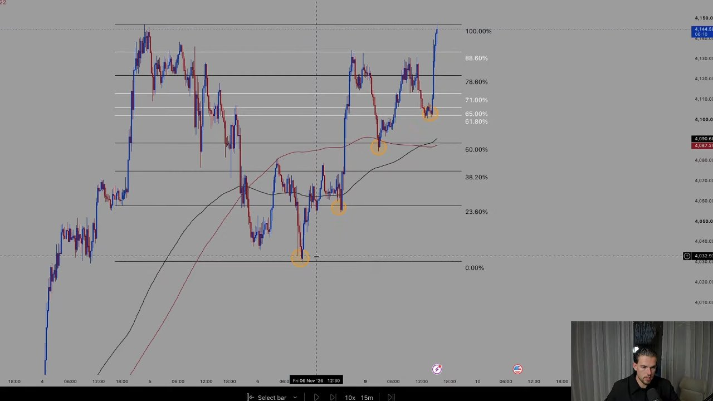

## 18. Sweep กับ Grab

🎬 **(นาที 1:06–1:09, 1:12):**
- **sweep** = การกระทำ — ไส้วิ่งไปกวาดระดับ
- **grab** = ผลลัพธ์ — ปิดแท่งกลับเข้ามา
- grab ที่ดีต้องมีปฏิกิริยา**เร็ว** · ถ้า grab แล้วนิ่งอยู่ระดับเดิมราว **30 นาที** มักจะไป grab ต่อ (ไกลกว่าเดิม)

🖼️ *(จากภาพ นาที 1:07:52)* Replay (Mon 09 Nov '26) · Fib ฝั่ง sell · กล่อง position: แดงเหนือ 88.6–100, เขียวด้านล่าง · วงกลมส้มที่ไส้บนแถว 88.6–100 · เส้นดำวาดมือ: ขึ้นไปกวาดไส้แล้วกลับลง

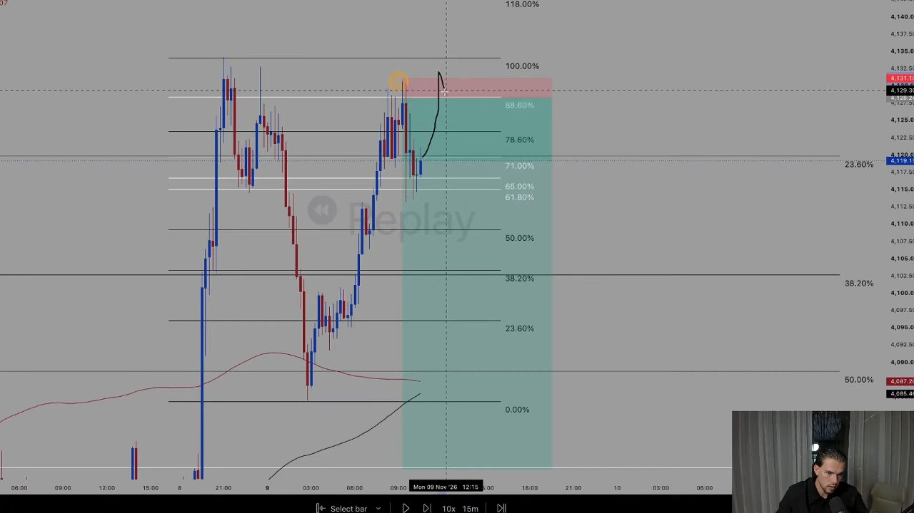

## 19. Breakout

🎬 **(นาที 1:14–1:15):**
- breakout = ทะลุแนวต้าน / แนวรับ = **ออกจาก structure** · ในแบบของเขา = ทะลุ 0% หรือ 100% ของ impulse
- เขา**ไม่เทรด breakout**
- หลัง breakout ราคามักวิ่งเร็วมาก หรือไม่ก็ fakeout กลับ

## 20. Fakeout

🎬 **(นาที 1:16–1:24):**
- fakeout = ออกจาก structure แล้ว**กลับเข้ามา**
- ตัวอย่าง: แนวต้านโดนชน 4 ครั้ง ครั้งที่ 5 ทะลุ → แท่งถัดมากลับลง = กวาด liquidity แล้วกลับตัว
- ทะลุตรงที่ไม่มี Fib / psychological level / MA อะไรเลย แล้วรีบซื้อ = ซื้อด้วยอารมณ์
- เห็นแท่งแรงอย่าตกใจ — ให้ถามว่า "**ทำไม**สถาบันดันแรงขนาดนี้" แล้วรอดูแท่งถัดไป
- ดูปฏิกิริยาหลังกวาด liquidity ทางซ้าย: **กลับลงเร็ว** → เขาว่าราว 90% เป็น fakeout · **ยืนเหนือได้** → มักไปต่อ
- ลำดับที่เขาดู: แท่งแรกปิดเหนือ (คนคิดว่าจะขึ้น) → แท่งที่ 2 กลับลงเร็ว = กวาดพอแล้ว
- ตัวอย่างที่ 2 เป็นแท่ง M15 ปิดเหนือแนวแล้วกลับ
- ใช้กับ Fib 61 ได้ · แต่ต้องมี Fib / confluence อื่นด้วย

🖼️ *(จากภาพ นาที 1:17:09)* Replay (Tue 27 Oct '26) · เส้นแนวต้านแนวนอน ~4,064 · แท่งขึ้นมาชนเส้นหลายรอบ (ช่วงที่นับ tap 1–4)

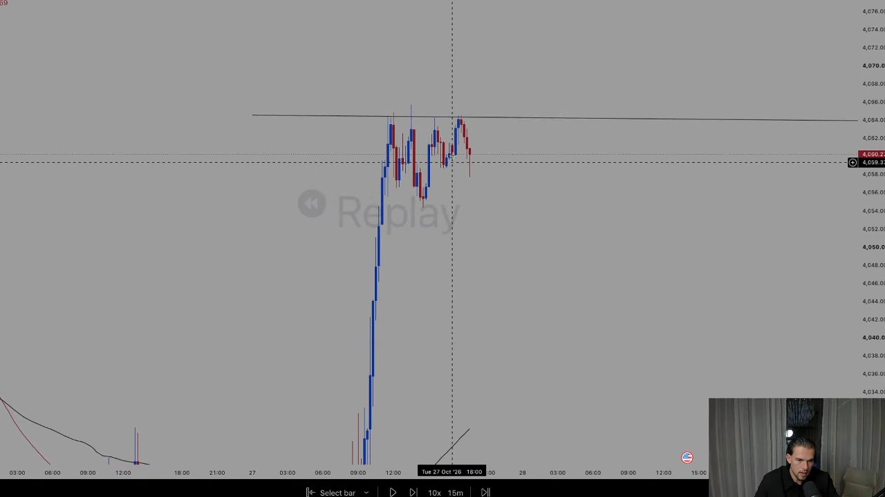

## 21. Trend line

🎬 **(นาที 1:31–1:34):**
- ใช้ไม่บ่อย (retail ใช้เยอะ) · เป็น **confluence เสริม** แบบเดียวกับ MA
- ลากผ่าน **low (liquidity) ที่ยังไม่ถูก sweep**
- ลากเมื่อมี **2 low** แล้วรอดูครั้งที่ **3–4** · ครั้งที่ 5 เขาไม่ชอบ
- ไม่ต้องเป๊ะ อย่าคิดซับซ้อน · ใช้ได้ทั้งขาขึ้นและขาลง

🖼️ *(จากภาพ นาที 1:33:53)* Replay (Mon 02 – Wed 04 Nov '26) · trend line ลากจากล่างซ้ายขึ้นขวา · วงกลมส้มที่ก้นที่แตะเส้น (~3,900 / ~3,921 / ~3,929) และก้นต่ำสุด ~3,874 · MA แดง/ดำผ่านแถวเดียวกัน

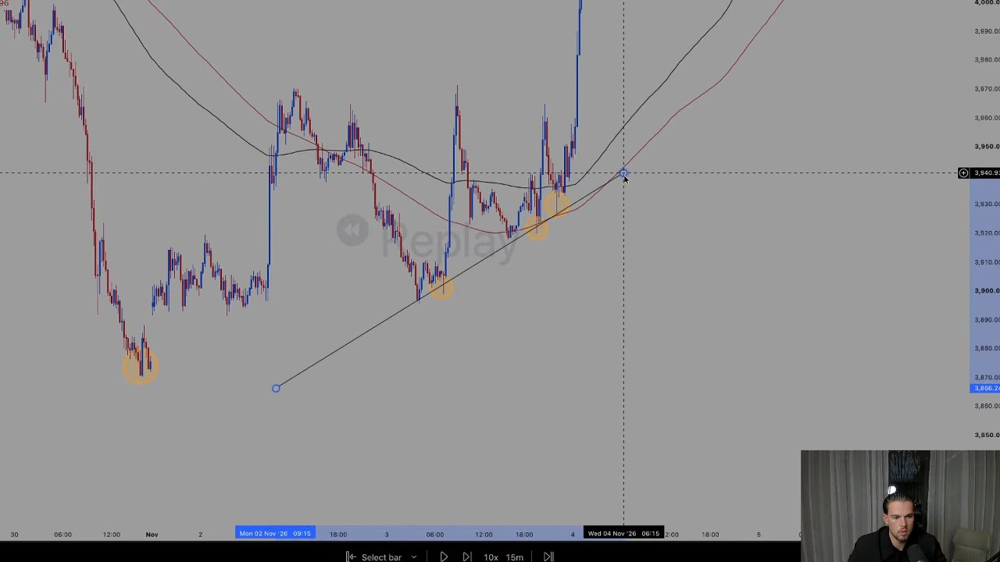

## 22. คำศัพท์ — Lot · Pip · Leverage

🎬 **(นาที 1:25–1:31):**
- **Lot:** ทอง 1 lot = **100 ออนซ์** → ที่ราคา ~4,140 ≈ **$414,000**
- **Pip:** ทอง 1 pip = **10 เซนต์** · **10 pips = $1** (4,000 → 4,001 = 10 pips)
- **Leverage:** ใช้เงินน้อยเปิด position ใหญ่ — 1:100 กับเงิน $1,000 = เปิดได้ $100,000 · เขาว่าใช้จริงแค่ ~1:20–1:30 · ไม่ต้องเปลี่ยนค่าที่โบรก ให้ดูจากขนาด position เทียบเงินในบัญชี

---

## คำถามที่ยังค้าง

- [ ] structure 4–5 แท่ง M5 — กรอบต้องแคบแค่ไหน · ต้องอยู่บนเส้น Fib พอดี หรือแค่ใกล้ ๆ (§12) · เขาบอกจะสอน session 2
- [ ] มีหลายคลื่น เลือก impulse ไหนลาก Fib (§3, §14)
- [ ] psychological level คืออะไร (§13) — ในคลิปพูดชื่อแต่ไม่อธิบาย
- [ ] "กลับขึ้นมาแถว 61" หลังแตะ 65 / 71 — ต้องปิดแท่งเหนือ 61 หรือแค่ใกล้ (§8)
- [ ] grab "เร็ว" แค่ไหน (§18) — มีแค่ "นิ่ง ~30 นาที = ไม่ดี"
- [ ] liquidity "ทางซ้าย" ที่ต้องรอที่ 88 คือระดับไหน (§10)
- [ ] fakeout ดูการปิดแท่ง TF ไหน (§20 ตัวอย่างพูดถึง M15)
- [ ] หน้าตั้งค่า Fib (นาที 30:01–30:24) ยังไม่ได้จับภาพ — ดึงเพิ่มได้

## 🤖 ข้อสังเกตของ AI (ไม่ใช่เนื้อหาในคลิป)

- **คำเดียวกัน ความหมายต่างกัน:** "structure" ของ Bills = ราคาสะสมบนระดับ (4–5 แท่ง M5) · ส่วน "โครงสร้าง" ในคลาส = โครงสร้าง Dow (ขาขึ้น / ขาลง / Sideway — [confirm.md §11](../confirm.md)) · คำอื่นที่ซ้ำกับคลาส: liquidity grab, fakeout — ยังไม่เทียบความหมาย (ตามหลักไม่รวมกับคลาส)
- ระดับ 65 / 71 / 88.6 / 118 ไม่อยู่ในชุดหลักที่คนส่วนใหญ่ใช้ (23.6 / 38.2 / 50 / 61.8 / 78.6) — น่าจะต้องเพิ่มเองในตั้งค่า
- ตัวเลขในคลิป (fakeout ~90%, 200 ดีสุดจากที่เขาลองมา 5 ปี, ผลเทรดเป็น pips) เป็นคำพูดของเขา ยังไม่มีใครตรวจ
- คลิปนี้เป็นส่วนหนึ่งของโปรแกรมรับสมัคร (ฝาก $1,000 กับโบรกเกอร์ที่เขาแนะนำผ่านลิงก์ของเขา · แจก Rolex · กลุ่ม VIP) — ควรรู้ไว้ตอนชั่งน้ำหนักคำพูด
