# ภาพ + คำพูด — Trading House Online Theory session #1 (ช่อง Bills)

> แหล่งภายนอก ไม่ใช่คลาส TrackleTrade · คลิป: https://www.youtube.com/watch?v=hqdcPzptcK0 · ซับเต็ม: [bills_theory01_hqdcPzptcK0.txt](bills_theory01_hqdcPzptcK0.txt)
> ภาพดึงจากวิดีโอตรง ๆ (1280×720) ผ่าน Chrome เมื่อ 2026-11-16 · **บนจอ** = AI อ่านจากภาพ · **พูด** = ซับอัตโนมัติช่วง −5 ถึง +25 วินาที (ถอดเสียงผิดได้)

## 12:28 — Fib

[▶ เปิดคลิปที่ 12:28](https://www.youtube.com/watch?v=hqdcPzptcK0&t=748s)

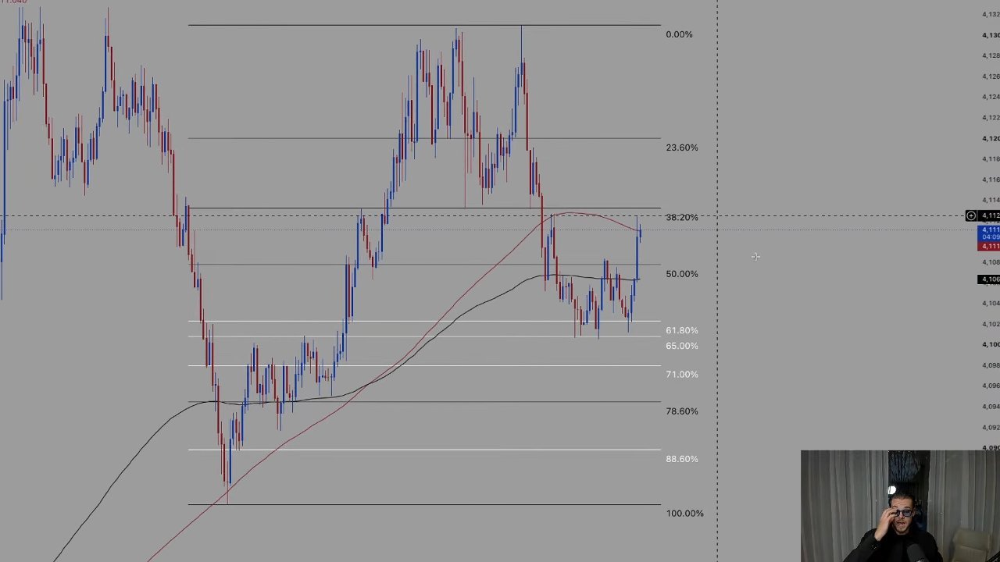

**บนจอ:** Fib ลากจากไส้ล่าง (~4,086 = 100%) ถึงยอด (~4,131 = 0%) · เส้น 23.6 / 38.2 / 50 / 61.8 / 65 / 71 / 78.6 / 88.6 — ช่วง 61.8–88.6 เป็นสีขาว · มีเส้น MA แดงกับดำ · ราคาตอนนั้น ~4,112 แถว 38.2

**พูด:**

> [12:28] have all of these fib levels. Okay, so we have the 23% retracement, we have 38%, we have 50%. And then you have
> [12:36] these ones that I put in white because they're my favorite one. Okay, so we have FIB61, FIB 65, FIB71, then you have FIB 78, and then you have FIB 888. Okay,
> [12:45] so this is the retracement that we have on the chart. I'll talk about each of them and how I use it differently, okay?
> [12:51] Because I think there's a lot of ways to use fib levels. Um, not everyone use it the same way. Some people use it as as

## 17:01 — Break & retest (วาดมือ)

[▶ เปิดคลิปที่ 17:01](https://www.youtube.com/watch?v=hqdcPzptcK0&t=1021s)

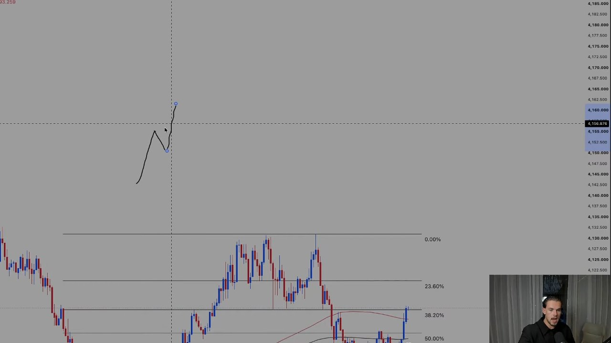

**บนจอ:** วาดด้วยพู่กันเหนือกราฟ: ขึ้น → ย่อ → ขึ้นทะลุยอดเดิม (ส่วน "break")

**พูด:**

> [17:01] Okay? So once this line is broke, most of the time we'll go and retest this uh resistance that now becomes a support.
> [17:09] Okay? So once you have your retest over here and most of the time it will be matched with fib 38. If you wait for a structure to stabilize then you can have
> [17:18] a nice move back up to the upside. So that's the I would say the best scenario possible to use fib 38. Okay. So let's say for example we have our fib here. We

## 20:49 — Break & retest + Fib 38

[▶ เปิดคลิปที่ 20:49](https://www.youtube.com/watch?v=hqdcPzptcK0&t=1249s)

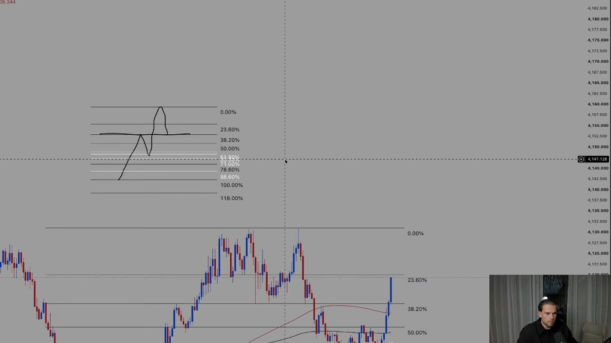

**บนจอ:** ภาพวาดมือ + Fib เล็ก (0–118%): ขึ้นทำยอด → ย่อ → ทะลุยอด → ย่อกลับมาแตะเส้นยอดเดิม (เส้นแนวนอน) ซึ่งตรงกับ 38.2%

**พูด:**

> [20:49] We can even make it clearer for you guys. Sorry. Okay. I think we can see really nicely now. So, we've had our fib that starts from here, 100%, goes up, we
> [20:58] make the new highs, then we come back down, then we've broke that line over here. So the fib level starts from the bottom until the top and then we retrace
> [21:06] on fib 38 break and retest. Then what do you do? You wait for a structure. We'll go through structure later. You wait for structure and then boom back to the

## 24:43 — Fib 61 → ไส้ลง 65

[▶ เปิดคลิปที่ 24:43](https://www.youtube.com/watch?v=hqdcPzptcK0&t=1483s)

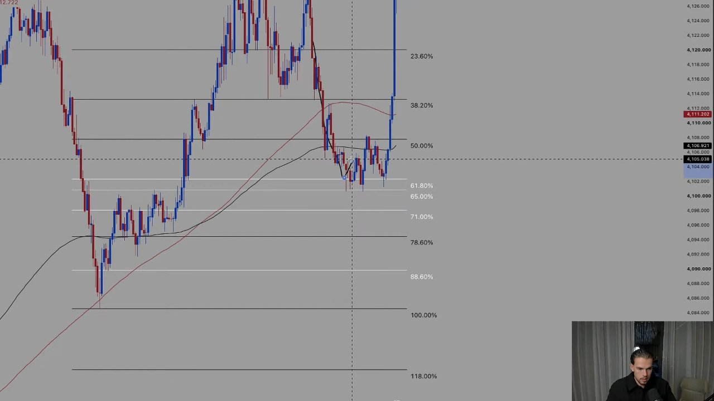

**บนจอ:** Fib ชุดเดิม · เส้นดำวาดมือ: ราคาลงมาแตะ 61.8 แล้วมีไส้ลงต่อแถว 65 ก่อนพุ่งขึ้น · แท่งน้ำเงินยาวขึ้นทะลุ 23.6

**พูด:**

> [24:43] looks like. We'll go back down, grab their stop loss just like we did here, okay, on fib 65 or on fib 71. Okay?
> [24:51] Because if you need to understand something is that most of the retail traders when they enter a trade on fib 61 they will put their stop loss either
> [24:59] on fib 65 just lower either on fib 71 lower or if someone is I would say
> [25:08] greedy he's going to put his stop loss on fib 88. Okay so this is thing that happens also there's some retail they enter on fib 61 they put stop loss on

## 35:29 — Fib 88

[▶ เปิดคลิปที่ 35:29](https://www.youtube.com/watch?v=hqdcPzptcK0&t=2129s)

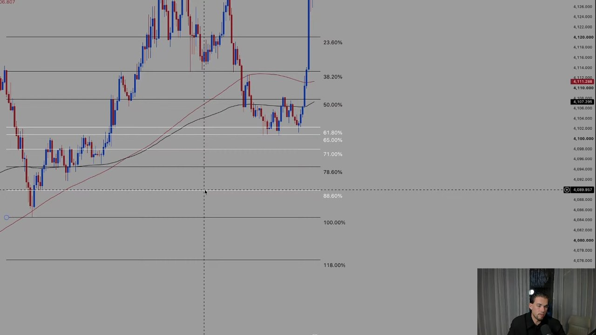

**บนจอ:** Fib ชุดเดิม (มีเส้น 118% เพิ่ม) · cursor ชี้ที่เส้น 88.6% (~4,090) · ไม่มีอะไรวาดเพิ่ม

**พูด:**

> [35:29] Okay. So, personally, let's say let's say I took a sell here on Fib88. Let's say I took this
> [35:38] cell here. My take profit my final take profit will be on Fib88.
> [35:45] So, what does that do? remove liquidity from the market so we can reverse. So it's a huge take-profit level and
> [35:53] say remove that it's also a huge stop-loss level. So if you were to take a bite I told you earl

## 46:34 — เวลาที่ส่งมา (t=2794s)

[▶ เปิดคลิปที่ 46:34](https://www.youtube.com/watch?v=hqdcPzptcK0&t=2794s)

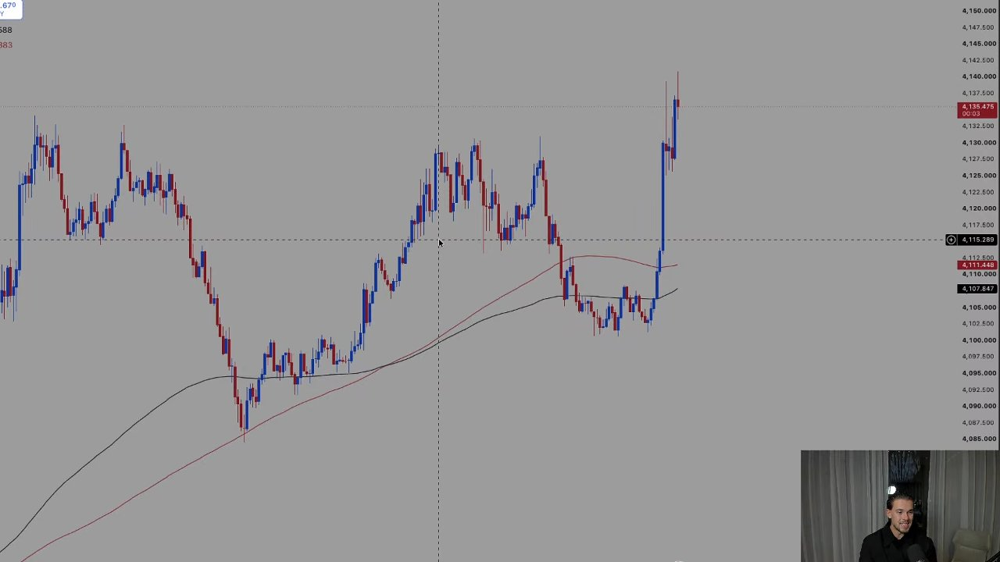

**บนจอ:** กราฟปัจจุบัน ไม่มี Fib แล้ว · ราคาพุ่งขึ้นถึง ~4,135 · มีแค่ MA แดง/ดำ — ภาพตัวอย่าง sell วันศุกร์ที่พูดถึงอยู่ช่วงนาที 45:14–45:50 (ก่อนเฟรมนี้)

**พูด:**

> [46:32] really important and we'll have to see different type of structure because there's a lot of different structure. It's never the same actually.
> [46:41] But if you um
> [46:44] [clears throat]
> [46:44] but if you learn uh some different type of structure, you'll be able to recognize them after. So it'll be easier. Will you teach about market structure? Okay, this one I read.
> [46:53] How do you draw small and big fibs?
> [46:55] Okay, good question. Uh small fib is on smaller time frame. So right now we're on M5. Okay, so let's say for example, this would be our small bib. Okay,

## 47:18 — Fib เล็ก / Fib ใหญ่

[▶ เปิดคลิปที่ 47:18](https://www.youtube.com/watch?v=hqdcPzptcK0&t=2838s)

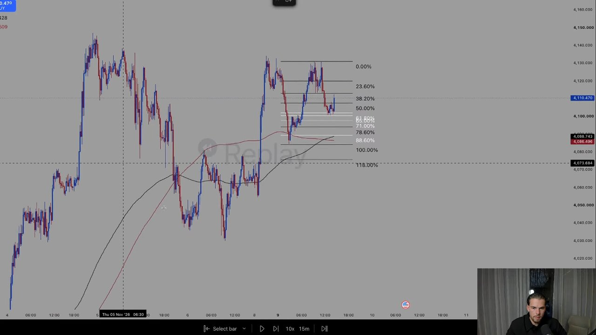

**บนจอ:** โหมด Replay บน M15 (Thu 05 Nov '26) · Fib ลากบนคลื่นล่าสุดด้านขวา (0% ~4,130 → 100% ~4,080 · ต่อถึง 118%)

**พูด:**

> [47:18] the bottom bottom bottom of uh the impulse that we've had. So here as you can see we've had big 38 over there. Big 61 over here. So that's why I'm saying
> [47:27] big now because we're on big fib. So big 61 is at 469.
> [47:31] Uh big fib 88 is at 4,042. So these are huge level and the more uh the more you go on higher time frame the more valid
> [47:39] your zone becomes. Okay. So uh this you need to remember if you're on higher time frame you will have uh better chance of winning a trade. What time

## 58:19 — EMA 200 / SMA 200

[▶ เปิดคลิปที่ 58:19](https://www.youtube.com/watch?v=hqdcPzptcK0&t=3499s)

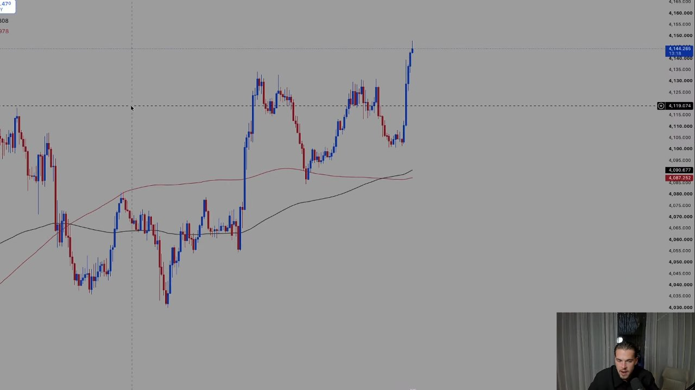

**บนจอ:** กราฟมี MA 2 เส้น (แดง/ดำ) · ป้ายตั้งค่าที่มุมซ้ายบนถูกตัด อ่านค่าในภาพไม่ออก

**พูด:**

> [58:17] EMA is the exponential moving average.
> [58:19] And as I said earlier, guys, you want to see my settings. I don't know if you can see at the left. Okay, check this here at the bottom. You see EMA 200, SMA 200.
> [58:28] If you want to have it on your chart, you click on indicator. Okay? Then you will click on EMA and you will see the first one
> [58:35] exponential moving average. You click on it. It will add. Once it will be added on your screen, you go and you try to
> [58:43] add SMA. Okay? So, you can do that. You can do it at the same time as me.

## 1:05:27 — โซน Liquidity 4 จุด

[▶ เปิดคลิปที่ 1:05:27](https://www.youtube.com/watch?v=hqdcPzptcK0&t=3927s)

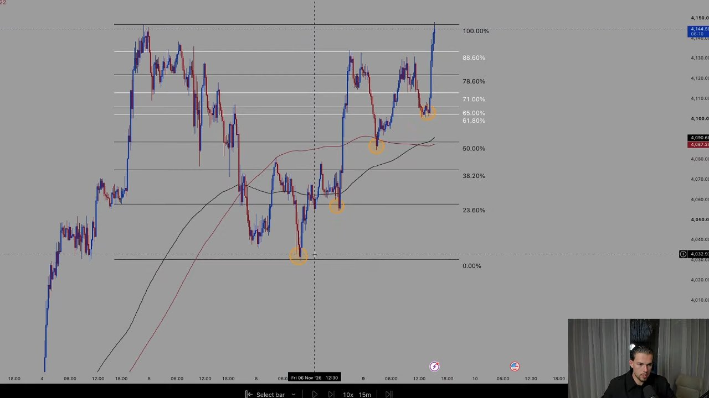

**บนจอ:** Replay M15 (Fri 06 Nov '26) · Fib 0% อยู่ล่าง (~4,032) 100% อยู่บน (~4,150) · วงกลมส้ม 4 จุด: ~4,032 (0%), ~4,057 (แถว 23.6), ~4,087 (แถว 50), ~4,103 (61.8–65)

**พูด:**

> [1:05:27] four zones of liquidity. So once you want to look for a trade, you will trace your fib. For example, for buys and you'll check which zone is matching with
> [1:05:36] my liquidity level. Here we have fib 38 match with a lot of liquidity. This is a good level. Uh fib 50, you wouldn't trade it because there's liquidity
> [1:05:43] below. Fib 61 is not bad. Uh but there's no liquidity attached to it. We have 578 with a bit of liquidity over there and
> [1:05:50] 100% always has some. Uh so here the best level possible honestly that would look for as of now if we don't make a higher high on this scandal would be at

## 1:07:52 — Sweep vs Grab

[▶ เปิดคลิปที่ 1:07:52](https://www.youtube.com/watch?v=hqdcPzptcK0&t=4072s)

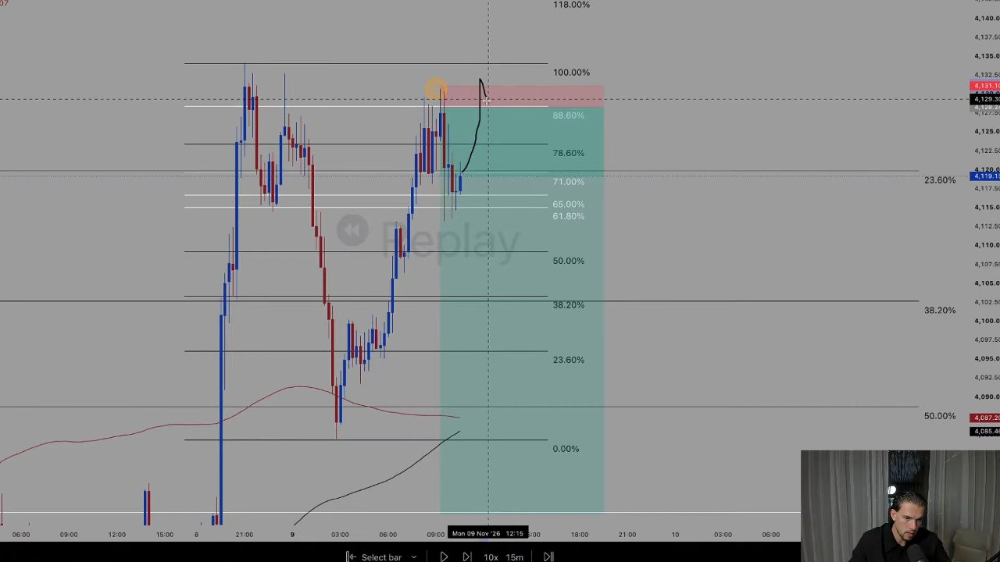

**บนจอ:** Replay (Mon 09 Nov '26) · Fib ฝั่ง sell · กล่อง position: แดงเหนือ 88.6–100, เขียวด้านล่าง · วงกลมส้มที่ไส้บนแถว 88.6–100 · เส้นดำวาดมือ: ขึ้นไปกวาดไส้แล้วกลับลง

**พูด:**

> [1:07:52] liquidity grab. So the grab is the result and the sweep is the action that we're taking. Okay? So if you don't know the difference between two, this is it.
> [1:08:01] Now let's say we go back to the chart. We say next candle. Next candle. Boom.
> [1:08:07] We've grabbed the greedy stop loss hit for everyone that entered over here is let's say we put it on the right one.
> [1:08:15] See stop loss hit over there.

## 1:17:09 — Fakeout (แนวต้านโดนชนหลายรอบ)

[▶ เปิดคลิปที่ 1:17:09](https://www.youtube.com/watch?v=hqdcPzptcK0&t=4629s)

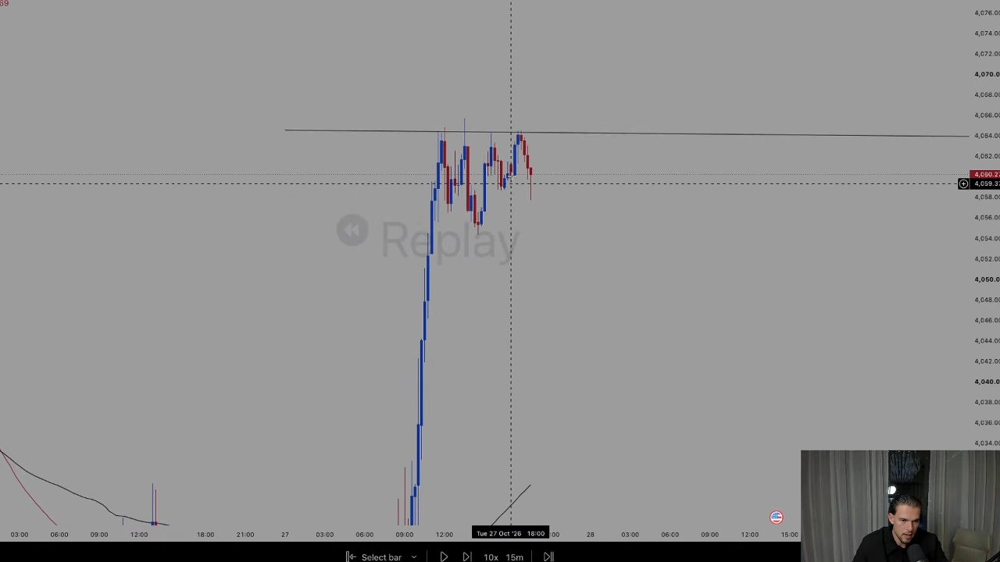

**บนจอ:** Replay (Tue 27 Oct '26) · เส้นแนวต้านแนวนอน ~4,064 · แท่งขึ้นมาชนเส้นหลายรอบ (ช่วงที่นับ tap 1–4)

**พูด:**

> [1:17:09] Fourth tap on it, comes back down. And then on the fifth one market decided to break out of it. Now a lot of retail trader trade in a way where they will
> [1:17:17] buy as soon as we'll break out. But this is it is really really really not smart and I'll show you why. Okay. So next
> [1:17:25] candle for example goes here then the next one does that.
> [1:17:30] As a retail you see this and if you trade with emotions or you act emotionally you'll be like oh my god we've broke this level. we're gonna fly.

## 1:33:53 — Trend line

[▶ เปิดคลิปที่ 1:33:53](https://www.youtube.com/watch?v=hqdcPzptcK0&t=5633s)

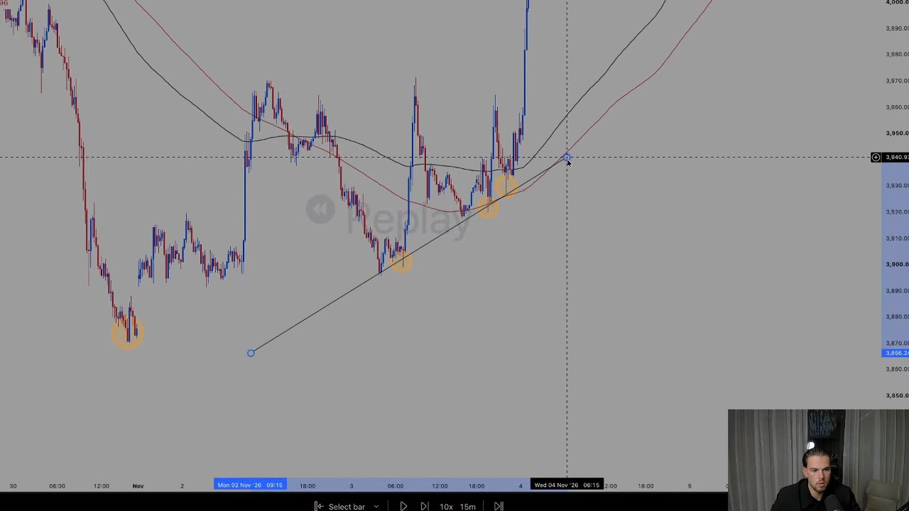

**บนจอ:** Replay (Mon 02 – Wed 04 Nov '26) · เส้น trend line ลากจากล่างซ้ายขึ้นขวา · วงกลมส้มที่ก้นที่แตะเส้น (~3,900 / ~3,921 / ~3,929) และก้นต่ำสุด ~3,874 · MA แดง/ดำผ่านแถวเดียวกัน

**พูด:**

> [1:33:49] like that. This one is pretty clean.
> [1:33:53] So this could be a nice trend line. You know, it just helps you when you have a fib levels. It's just an extra confluence that you can use. So when you trace your fib from this low for example
> [1:34:00] till the highs over here we've had fib 61 we've had liquidity levels we've had EMA SMA and we've had a structure you
> [1:34:08] know so this becomes like a really nice level to buy you know so it's just now we have like more confluence fib levels
> [1:34:15] fib 61 we've grabbed on FIB 71 moving average and we have a trend line passing by so it just makes the trade more valid
